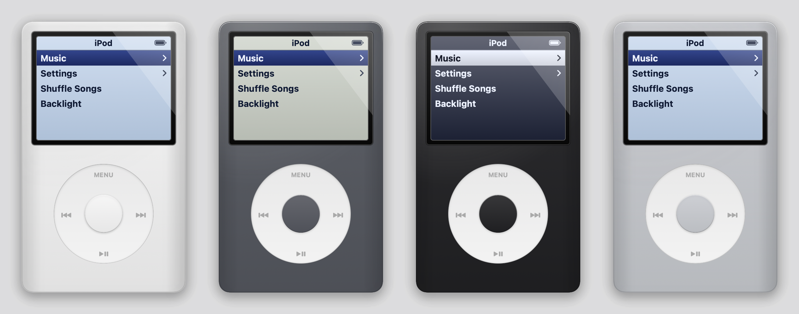

# iPod Widget

맥 바탕화면에 iPod classic 모양의 위젯을 띄우고, 클릭휠로 Apple Music(음악 앱)을 조작하는 macOS 앱입니다.



## 기능

- **바탕화면 위젯**: 바탕화면 아이콘보다는 위, 일반 창보다는 아래에 떠 있고 모든 데스크톱(Space)에 고정됩니다. 본체를 드래그해 옮길 수 있고, 옮긴 위치는 저장됩니다.
- **클릭휠 조작**
  - 휠을 원을 그리듯 드래그하거나 트랙패드로 스크롤하면 메뉴 선택이 움직입니다.
  - 가운데 버튼은 선택, `MENU`는 뒤로가기입니다.
  - `⏮` `⏭` `▶‖`은 이전 곡, 다음 곡, 재생/정지입니다.
  - Now Playing 화면에서 휠을 돌리면 볼륨이 바뀝니다.
- **iPod 메뉴**
  - `Music`: 하위 메뉴 `Playlists` / `Artists` / `Songs`에서 보관함 곡을 찾아 재생합니다.
  - `Settings`: 셔플과 반복 재생을 설정합니다.
  - `Shuffle Songs`: 보관함 전체를 섞어서 재생합니다.
  - `Backlight`: 화면 백라이트를 켜고 끕니다.
  - `Now Playing`: 재생 중일 때만 나타나며, 곡 정보·앨범아트·진행바를 보여줍니다.
- **디자인 변경**: 메뉴바 아이콘 → `Customize…`에서 기기 색상과 화면 색상을 바꿀 수 있습니다. 프리셋과 색상 피커를 모두 지원하고, 휠은 항상 흰색, 가운데 버튼은 기기 색을 따릅니다.

## 요구 사항

- macOS 14 이상
- Xcode(Swift 툴체인 포함)
- 음악 앱(macOS 기본 앱)

## 빌드와 실행

```bash
git clone https://github.com/js-lee05/ipod-widget.git
cd ipod-widget
./scripts/build_app.sh
open build/iPodWidget.app
```

`build_app.sh`는 릴리스 빌드 후 `build/iPodWidget.app` 번들을 만들고 ad-hoc 서명합니다. 한 번 만든 뒤에는 다시 빌드할 필요 없이 `iPodWidget.app`을 더블클릭해 실행하면 됩니다.

- **종료**: 메뉴바 iPod 아이콘 → `Quit iPod Widget`
- **응용 프로그램 폴더에 설치**: `cp -R build/iPodWidget.app /Applications/` (설치하면 Spotlight에서 실행할 수 있습니다)
- **로그인 시 자동 실행**: 시스템 설정 → 일반 → 로그인 항목에 추가

## 처음 실행할 때

음악 앱을 켠 뒤 위젯에서 `Music` 메뉴로 들어가면, macOS가 "iPod Widget이 '음악'을 제어하려고 합니다"라고 묻습니다. 허용하면 됩니다.

거부했다면 시스템 설정 → 개인정보 보호 및 보안 → 자동화에서 iPod Widget 아래의 `음악`을 켜세요. 앱을 다시 빌드하면 서명이 바뀌어 권한을 다시 물을 수 있습니다.

## 동작 방식

위젯은 소리를 직접 재생하지 않습니다. AppleScript로 음악 앱에 명령(재생, 다음 곡, 볼륨 등)을 보내고, 음악 앱이 켜져 있는 동안 1초마다 재생 상태를 받아와 화면에 표시합니다. 음악 앱이 꺼져 있으면 상태를 조회하지 않습니다(조회만 해도 음악 앱이 켜지기 때문입니다).

## 제한 사항

- 메뉴에는 음악 앱 **보관함에 있는 곡**만 나옵니다. Apple Music 곡은 "보관함에 추가"를 해야 보입니다.
- `Artists`와 `Songs`에서 곡을 고르면, 그다음 곡은 위젯 목록 순서가 아니라 보관함 순서대로 이어집니다. 원하는 순서대로 들으려면 `Playlists`를 사용하세요.
- 아티스트 정보가 비어 있는 곡은 `Artists`에 나오지 않습니다(`Songs`에서는 보입니다).

## 프로젝트 구조

```
Sources/
  IPodCore/          UI와 무관한 로직 (테스트 대상)
    MusicScripts.swift   음악 앱 AppleScript 생성, 곡 ID 검증
    MusicParser.swift    AppleScript 결과 파싱
    MenuNavigator.swift  메뉴 이동·스크롤 로직
    Theme.swift          테마 모델, 프리셋, 색 계산
    Models.swift         재생 상태·곡·플레이리스트 모델
  iPodWidget/        macOS 앱
    AppDelegate.swift    위젯 창, 메뉴바 아이콘, Customize 창
    AppModel.swift       휠 입력 처리, 상태 조회, 메뉴 동작
    MusicController.swift AppleScript 실행·오류 처리
    ThemeStore.swift     테마 저장(UserDefaults)
    Views/               iPod 본체·화면·클릭휠·설정 창
Tests/IPodCoreTests/ 단위 테스트
scripts/build_app.sh .app 번들 빌드 스크립트
Resources/Info.plist 앱 번들 설정
```

## 테스트

```bash
swift test
```
